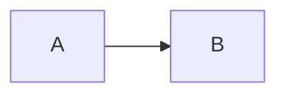

# Markdown authoring

This is the canonical source-authoring guide for YADG.

Markdown owns maintainable semantic content. `YADG.md` owns workspace configuration such as Markdown policy, values, diagram auto-detection, external producers, and publication defaults. Prepared DOCX templates own presentation and Word-native structure.

For template construction, see [DOCX template authoring](DOCX-TEMPLATE-AUTHORING.md).

## Workspace and source files

A typical workspace contains:

```text
MyReport/
├── YADG.md
├── content.md
├── chapters/
│   └── architecture.md
├── images/
│   └── context.png
└── YadgTemplates/
    └── report.docx
```

YADG discovers Markdown source recursively while pruning dot directories and YADG-owned/generated directories. Linked child directories are not recursively followed.

Use:

```powershell
yadg check --list
```

to inspect discovered sources, templates, and referenceable semantic objects.

## Supported Markdown profile

YADG accepts a constrained, Markdig-based profile: CommonMark blocks and inlines, pipe and Pandoc-style grid tables, GFM strikethrough and task markers, plus explicit `{#id}` attributes on supported semantic objects. Supported authoring includes fenced and indented code, nested lists, and blockquotes. This is not full Pandoc, MyST, or GitHub-flavored Markdown compatibility; unsupported extensions are outside the contract.

| Authoring intent | Syntax | Word result |
|---|---|---|
| Link to a rendered semantic object | `[the model description](#liquidity-model)` | Clickable link; preserves exactly “the model description” |
| Generate a heading number | `Section [@architecture]` | Updateable Word `REF` field for the heading number |
| Generate a figure number | `Figure [@system-context]` | Updateable `REF` field; configured label-number mode uses its caption prototype |
| Generate a table number | `Table [@interfaces]` | Updateable `REF` field; configured label-number mode uses its caption prototype |
| Link to an external URL or file | `[reference](https://example.com)` | Normal hyperlink retaining its authored wording |

Ordinary Markdown links and generated references are different constructs. A fragment link never replaces its words with a title or number. `[@id]` emits only the configured generated reference; write any surrounding prose and label yourself.

Internal fragment links require one explicit stable ID and a target that renders exactly once in the selected DOCX. A target omitted by template placement, such as a heading whose template uses only `{{content:id}}`, is not a rendered heading target. Strict `check` reports broken, ambiguous, and non-rendered targets. Under YOLO, unresolved internal links keep their authored wording and are reported as unclickable degradations.

## Stable IDs

Stable IDs identify semantic objects across source files and templates.

Heading:

```markdown
# Architecture {#architecture}
```

Table:

```markdown
| Component | Purpose |
|---|---|
| YADG | Authors DOCX |
{#components}
```

Figure:

<!-- M0015-example: markdown-figure -->
````markdown
{#system-context}
````

Explicit text diagram:

````markdown
```diagram {#system-flow caption="System flow"}
┌──────────┐
│ Gateway  │
└────┬─────┘
     ▼
┌──────────┐
│ Worker   │
└──────────┘
```
````

IDs are workspace-wide. Duplicate or ambiguous IDs are errors, including under YOLO.

## Sections and content

Given:

```markdown
# Architecture {#architecture}

Introductory text.

## Assumptions

Details.
```

A DOCX template can insert the selected heading plus body with:

```text
{{section:architecture}}
```

or only the body with:

```text
{{content:architecture}}
```

Source heading levels remain semantic hierarchy. YADG composes the effective Word heading level relative to the prepared template context.

## Paragraphs and inline content

YADG supports ordinary paragraph text and the documented inline subset, including emphasis and strong emphasis.

Semantic numeric references use:

```markdown
See Section [@architecture].
```

The reference emits only its configured Word result when the target has the required numbering/reference structure. With no `references` settings, it remains the legacy numeric-only output. Source text owns labels such as “Section”, “Figure”, or “Table” in that default mode.

### Generated reference display

Configure generated reference display once in the root `YADG.md` front matter:

```yaml
---
yadg:
  version: 1

references:
  headings: number
  figures: label-number
  tables: label-number
---
```

`headings` accepts only `number`. `figures` and `tables` accept `number` or `label-number`. Omitted settings mean `number`, preserving existing projects. Unknown keys and values fail validation. This setting changes only generated `[@id]` references; it does not affect `[authored words](#id)`.

In `label-number` mode, the actual DOCX caption prototype supplies the label, its spacing/punctuation, and the sequence field format. YADG creates a Word field targeting that prototype-derived label and `SEQ` number. If the selected template cannot supply a clear label and sequence target, strict validation reports a template capability error. YADG never translates or hardcodes caption labels or cached numerals.

## Lists

Ordered and unordered lists support mixed nesting through nine Word numbering levels.

<!-- M0015-example: markdown-unordered-list -->
````markdown
- First
- Second with **emphasis**
````

<!-- M0015-example: markdown-ordered-list -->
````markdown
1. First
2. Second
   - Nested unordered item
````

Task markers `[ ]`, `[x]`, and `[X]` in list items render as static checkbox glyphs. List items may contain one paragraph and nested lists; unrelated block content and multi-paragraph list items are not supported. Blockquotes support paragraphs, inline formatting, links, and nested blockquotes.

List presentation is controlled by the DOCX template through styles, numbering, or prototypes.

## Tables

Pipe tables require stable IDs:

<!-- M0015-example: markdown-table -->
````markdown
| System | Protocol |
|---|---|
| Alpha | HTTPS |
| Beta | SFTP |
{#interfaces caption="Interfaces"}
````

Templates may allow YADG to generate the table or may provide a prepared table-row prototype. The Markdown table remains the semantic data source in either case.

## File-backed figures

Figures are block Markdown images with stable IDs:

```markdown
{#system-context}
```

Supported source image formats are:

```text
PNG
JPEG/JPG
```

The image target is relative to the Markdown source file and must remain lexically inside the workspace. Remote URLs and data URIs are unsupported.

Source-file SVG figures are not enabled by text-diagram support. SVG is used only as YADG's internal generated product for built-in text diagrams.

## Captions and references

Figure alt text is semantic caption text.

Tables and diagrams can carry captions according to their syntax. Numeric figure/table references require truthful template caption/numbering mechanics; YADG does not invent numbering when the template cannot provide it.

## Markdown policy

The workspace schema remains version 1.

Configure unsupported-construct behavior in `YADG.md`:

<!-- M0015-example: workspace-schema-v1 -->
```yaml
---
yadg:
  version: 1

markdown:
  thematicBreak: ignore
  codeInline: ignore
---
```

### Thematic breaks

Accepted values:

```text
error
ignore
```

Default is `style` for inline code. A matching template character style is required when styled inline code is present. Explicit `error` and `ignore` remain available.

Pipe tables are the preferred form for simple rectangular data. Pandoc-style grid tables support multiline cell paragraphs and horizontal/vertical cell spans. Cells may contain paragraphs and supported inline content; nested tables, lists, headings, images, and fenced code blocks are rejected with a diagnostic.

Fenced and indented code blocks are emitted literally with source indentation and line boundaries preserved. Blockquotes support paragraphs and nested blockquotes without synthetic labels. `~~struck~~` uses Word strike formatting. Task markers `[ ]`, `[x]`, and `[X]` become static checkbox glyphs rather than interactive controls.

### Inline code

Accepted values:

```text
error
ignore
style
```

Default is `error`.

`ignore` preserves code text as ordinary text. `style` requires a suitable template character-style role.

Ordinary fenced and indented code blocks are emitted as literal code. Explicit `mermaid` fences and the supported text-diagram fence forms described below retain their diagram behavior.

# Diagramming in Markdown

YADG has two intentionally different diagramming paths.

## Text diagram or Mermaid?

| Need | Built-in text diagram | Mermaid |
|---|---|---|
| Layout authority | the character grid you type | Mermaid graph/diagram semantics |
| External tool required | no | yes, configured trusted producer |
| YADG intermediate image | generated SVG | producer-generated PNG |
| Best for | compact architecture sketches, flows, nested boxes, hand-positioned diagrams | larger semantic graphs, automatic layout, Mermaid-supported diagram types |
| Placement/reference | ordinary semantic figure when identified | ordinary semantic figure |
| Auto-detection | optional for unlabeled/`text` fences | no |
| Network required by YADG | no | no; producer/tool provisioning is external to YADG |

Choose a text diagram when the plain-text layout itself is useful source and you want exact source-controlled positioning. Choose Mermaid when the diagram should be described semantically and laid out by Mermaid.

They are not aliases for the same renderer.

## Built-in text-grid diagrams

Use exact lowercase `diagram`, a stable ID, and optionally a plain caption:

<!-- M0015-example: explicit-text-diagram -->
````markdown
```diagram {#service-flow caption="Service flow"}
┌────────────┐
│ Outer      │
│ ┌──────┐   │
│ │Inner │   │
│ └───┴──┘   │
└─────┼──────┘
      │
      ▼
```
````

The source characters and whitespace define the grid. YADG does not arrange nodes or route edges.

Supported structural vocabulary includes at least:

```text
─ │ ┌ ┐ └ ┘ ├ ┤ ┬ ┴ ┼
→ ← ↑ ↓ ► ◄ ▲ ▼
```

and connected ASCII forms:

```text
- | + > < ^ v
```

Ordinary text remains text positioned on the grid.

### Standalone arrows

Unicode arrows can be useful even when not joined directly to another line cell. Explicit diagrams can therefore express vertical flows such as:

<!-- M0015-example: standalone-arrow-diagram -->
````markdown
```diagram {#pipeline}
Input
  ↓
Transform
  ↓
Output
```
````

A lone arrow by itself is not enough to qualify an auto-detected block.

### Nested boxes

Containment is visual rather than semantic:

<!-- M0015-example: nested-box-diagram -->
````markdown
```diagram {#nested}
┌────────────────┐
│ Outer          │
│  ┌──────────┐  │
│  │ Inner    │  │
│  └──────────┘  │
└────────────────┘
```
````

### Overlap and occlusion

A higher rectangle may visually cover part of a lower rectangle. YADG reconstructs hidden lower geometry only when one recognized covering rectangle explains the interruption unambiguously.

The hidden part may include a corner:

<!-- M0015-example: corner-occlusion-diagram -->
````markdown
```diagram {#overlap}
┌────────┐
│lower   │
│        │
│      ┌─┼───┐
└──────│     │
       │     │
       └─────┘
```
````

The visible grid remains the authoring authority. YADG does not invent hidden geometry through uncovered or ambiguous gaps.

Connectors may cross a box boundary; boxes are not clipping regions.

### Figure behavior

An explicit identified diagram is an ordinary semantic figure. It supports:

- natural Markdown placement;
- direct `{{figure:id}}` placement in a template;
- captions;
- bookmarks/numbering when the template provides truthful caption mechanics;
- `[@id]` references under the normal figure rules.

Generated SVG is passive and self-contained and is embedded in the authored DOCX. It is not written as workspace source/cache.

## Optional text-diagram auto-detection

Auto-detection is disabled by default.

Enable it in root `YADG.md` front matter:

<!-- M0015-example: autodetect-schema-v1 -->
```yaml
---
yadg:
  version: 1

diagrams:
  autoDetect: true
---
```

Only these fenced blocks are candidates:

- unlabeled fences;
- exact lowercase `text` fences.

Other language-tagged fences are never auto-detected.

Detection reuses the real diagram parser and requires strong renderable geometry such as a complete/reconstructable rectangle, connected arrow path, branching/joining component, or substantial multi-row box drawing.

YADG deliberately prefers false negatives over false positives. Examples such as:

<!-- M0015-example: autodetect-weak-negative -->
````markdown
```text
A -> B
```
````

ordinary key/value text, aligned prose, or isolated punctuation do not qualify merely because they contain diagram-like characters.

A weak candidate keeps the normal unsupported-fenced-block behavior.

### Anonymous detected diagrams

An unlabeled detected diagram has no public semantic ID. It renders naturally at its source location and has:

- no `{{figure:id}}` target;
- no `[@id]` reference;
- no caption/numbering/bookmark;
- no `check --list` reference entry.

A successfully detected exact `text` fence can become an identified figure when it carries normal attributes:

<!-- M0015-example: autodetect-identified-positive -->
````markdown
```text {#detected-flow caption="Detected flow"}
┌──────┐
│  A   │
└──┬───┘
   ▼
```
````

## Mermaid diagrams

Mermaid remains an external content-producer feature.

Configure a trusted producer in `YADG.md`, for example:

<!-- M0015-example: mermaid-producer-config -->
```yaml
producers:
  mermaid:
    executable: mmdc
    arguments: []
```

Then author:

<!-- M0015-example: mermaid-source-fence -->
````markdown

````

A Mermaid block is a semantic figure. YADG runs the configured external producer with the user's permissions and consumes its PNG result through the normal figure path.

YADG does not install Mermaid tooling automatically and does not treat the producer as sandboxed code.

Under YOLO, an external-producer failure may become an obvious placeholder according to the existing resilience contract. Built-in text diagrams do not use that external producer path.

## Strict and YOLO for source authors

Strict mode is the production-correctness contract.

```powershell
yadg check
yadg build
```

YOLO is explicit:

```powershell
yadg check --yolo
yadg build --yolo
```

YOLO may preserve unsupported/recoverable content visibly where the resilience specification permits it, but it does not invent semantic identity or silently guess ambiguous text-diagram geometry.

Malformed explicit diagram syntax or ambiguous explicit geometry remains an error unless an existing generic resilience rule explicitly applies.

## Related guides

- [Getting started](GETTING-STARTED.md)
- [DOCX template authoring](DOCX-TEMPLATE-AUTHORING.md)
- [Troubleshooting](TROUBLESHOOTING.md)
