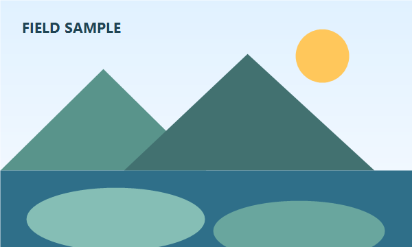

# Narrative overview {#content}

This paragraph was authored in the shared M0018 compatibility source.

### Design intent

The fixture demonstrates a template-owned content heading.

- Readable default body formatting
  - A nested list remains editable

# Audience choices {#two-columns}

## Left column {#left}

The left column keeps its own prototype formatting.

- First left point
  - Nested left detail

## Right column {#right}

The right column uses a separate native text placeholder.

- First right point
  - Nested right detail

# Architecture map {#text-image}

## Summary {#text}

This text sits beside an ordinary editable PowerPoint image.

## Diagram {#image}

# Measures {#table}

| Measure | Value |
|---|---:|
| Coverage | Four layouts |
| Editing | Native objects |
